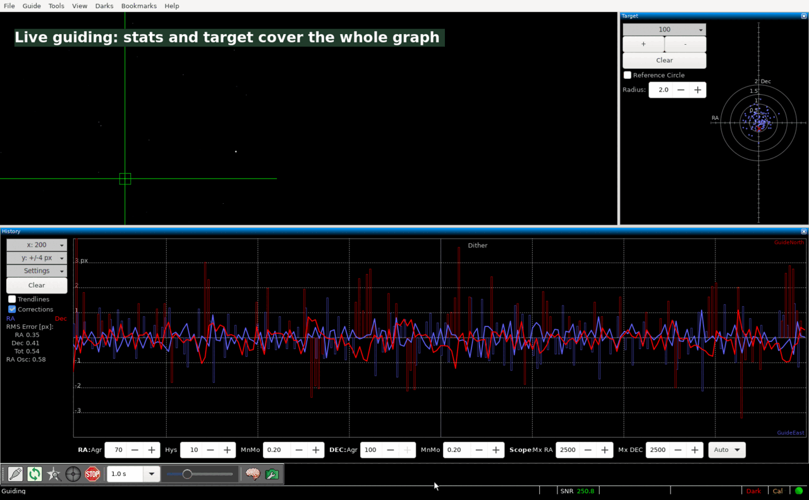
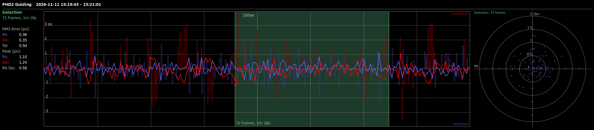

### PHD2 Guiding

PHD2 is telescope guiding software that keeps your telescope locked on target, letting you concentrate on other aspects of astro-imaging or spectroscopy.

### About this fork

This is a personal fork of [OpenPHDGuiding/phd2](https://github.com/OpenPHDGuiding/phd2) that adds the features below on top of upstream `master`. Windows builds are on the [Releases](https://github.com/dmead/phd2/releases/latest) page. It is not an official PHD2 release; for official builds and support, use the links further down.

### Fork features

#### Guide graph range selection

Drag across the guide graph to select a range of frames:

- The RMS Error (RA, Dec, Tot) and RA Osc values on the left are computed from the selected frames only. The heading changes to "Selection RMS [px]" and the values turn green.
- The Target plot shows only the selected frames.
- The highlighted band shows the frame count and duration, and stays attached to its frames as the graph scrolls.
- Frames taken while dithering or settling are left out of RMS, the same as in the normal stats.
- Click the graph to clear the selection. Ctrl+click still clears part of the history, as before.

Right-click the graph (or open its Settings menu) for **Copy Image to Clipboard** or **Save Image...**. Either one produces a single PNG with the time range, RMS, peak and RA Osc stats, the graph and the Target plot:

### Web site

  https://openphdguiding.org

### User support forum

  https://groups.google.com/g/open-phd-guiding

### Contributing to PHD2

  https://github.com/OpenPHDGuiding

If you have an idea for a PR, please submit a Github issue for discussion with the developers. We are no longer accepting PRs from all Github users as the maintainers all work on PHD2 in our limited free time, and the increased number of LLM-generated PRs exceeds our capacity to handle them.